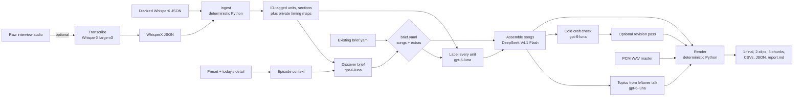
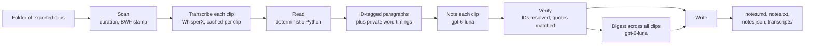
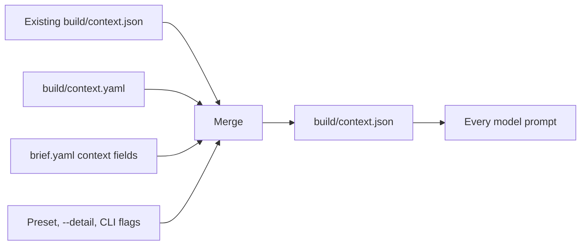
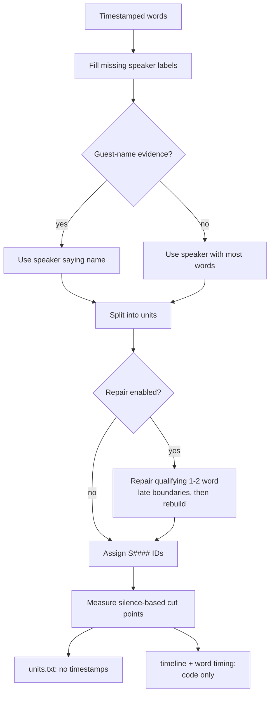
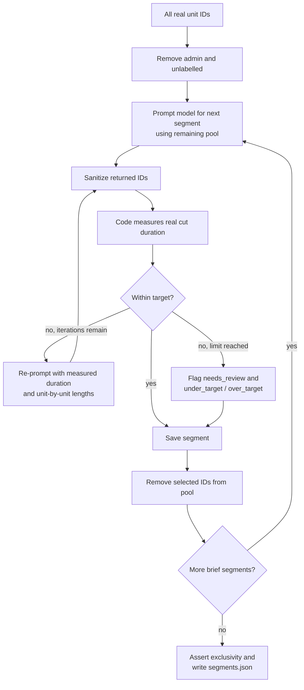
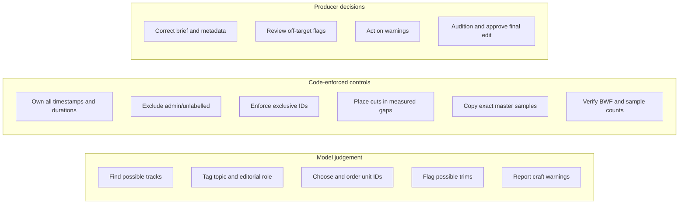

# Cutdown: ingest-to-output process

This guide explains how `cutdown` turns a diarized interview transcript and its
master WAV into track-anchored radio segments, and how its second mode,
[`cutdown notes`](#notes-mode-exported-clips-to-a-shareable-document), turns
clips already exported from a finished edit into a document a producer can send
on. It describes the current code and default configuration as of 24 September
2026.

The central constraint is simple: **models may select and reorder existing
speech, but they do not write speech and never receive timestamps**. Python code
owns timing, exclusivity, cut placement, audio copying, and final validation.

Notes mode is the one place a model writes prose, and the constraint holds in
the part that matters: the transcript on the page is verbatim, the model works
from paragraph IDs, every timestamp printed is measured by code, and a quote
that is not in the transcript word for word is dropped rather than published.

## What goes in and what comes out

Minimum production inputs:

- A diarized WhisperX JSON file containing `word_segments`, or raw audio from
  which `cutdown` can create that JSON.
- An uncompressed PCM WAV master to cut.
- A YAML brief listing the ordered segments, their anchor tracks, and target
  durations. `discover` drafts one when there is none; correct it.
- Preferably, episode context: a saved preset for the show, today's detail on
  what is in the recording and what to keep, and the guest name.

The principal user outputs are:

- `1-final/`: one finished file per song segment, then one per topic of leftover
  talk, clips joined with a short gap.
- `2-clips/`: sample-accurate BWF clips behind each finished file, a folder each,
  retaining their original master positions.
- `3-chunks/`: the whole recording, unedited, cut at its sections (the long
  silences) and named for what is in each.
- A clip manifest, rejected-material log, render summary, and producer report.
- All intermediate data and raw model request/response artifacts for audit and
  recovery.



Discover runs only when there is no brief (or when forced), so a brief the
producer supplied or corrected is never overwritten. `cutdown run --until
discover` stops after drafting it, for review.

## Recommended user workflow

### Studio workflow

Start Studio with raw audio:

```sh
cutdown                            # asks for the audio file, then runs everything
cutdown today.wav --preset radio   # the same, with the answers given
```

With no command, `cutdown` asks for the file, opens the context screen on a new
episode (the last preset used is preselected), and **Start** runs every stage.
On an episode that already has context it runs whatever is not current straight
away. The steps below are for working stage by stage instead.

or explicitly:

```sh
cutdown studio --audio audio/interview.wav --preset radio
```

The episode folder defaults to `ep/<audio name>` inside the project, wherever
the command is run from. For a new episode, the safest
sequence is:

1. The context screen opens. Pick a preset, add today's detail (how many songs,
   how it was recorded, what to keep), and Apply. Save it as a preset if it will
   come up again.
2. Focus **discover** and press `enter`: transcribe, ingest and discover run in
   turn. (Or `r` to run everything and review afterwards.)
3. Press `e`, correct `brief.yaml`, and save it. In particular, verify every
   artist, title, segment order, target range, the master path, and
   `extras.keep`.
4. Press `r` for **label**, **assemble**, **topics**, **check**, and **render**.
5. Play each song and topic with `space`, read the warnings, and inspect
   `report.md` before importing clips into Pro Tools. `o` opens `1-final/`.

Useful Studio keys are `c` for the context screen, `enter` to run the selected
stage, `f` to force it, `r` to run all non-current stages, `e` to edit the brief,
`space` to play, `s` to stop playback, `o` to open the output, and `d` to toggle
prompt-only dry-run mode.

Do not use an unreviewed Discover result as a production run sheet. Discover is
deliberately a draft: both ASR and a model can misidentify record names.

### One-command workflow

From raw audio, with a preset and today's detail:

```sh
cutdown run --audio audio/interview.wav --preset radio \
  --detail "four or five songs; keep the other chat, sorted into topics"
```

From an existing WhisperX JSON and a corrected brief:

```sh
cutdown run \
  --brief brief.yaml \
  --json out/interview.json \
  --master audio/interview.wav \
  -o ep/my-episode
```

The chained `run` command executes Transcribe when needed, then Ingest,
Discover (only when there is no brief), Label, Assemble, Topics, Check, and
Render, and ends with a table of what ran and how long it took. `--until
discover` stops after the brief is drafted.

## Notes mode: exported clips to a shareable document

`cutdown notes` is the second mode, and it runs in the opposite direction to the
pipeline above. It assumes the edit has already been made by hand in the DAW and
the clips have already been exported. What it produces is not audio: it is the
document a producer sends on — a readable transcript of each clip, with the
anecdotes in it summarised and timestamped.

```sh
cutdown notes ~/Desktop/interview-clips -o ep/interview/notes \
  --guest "Alex Vale" --host "Morgan Reed" --show "Record Room"
```

Passing no path at all prompts for the folder, as `cutdown transcribe` does.
Files and folders may be mixed; a folder is read one level deep only, so a
nested session or a `_previous/` archive is never transcribed by accident. Two
clips with the same filename are refused, because every artifact in the mode is
named after the clip it came from.



### What each step contributes

**Scan** reads duration, sample rate and the BWF `bext` chunk straight off each
file. A Pro Tools export normally carries a `TimeReference`, which is the clip's
position in the session the edit was made in. When every clip has one, the
document is ordered by it and each clip states where in the interview it came
from; when any clip lacks one, ordering falls back to filenames and the log says
so. Non-WAV clips are accepted, with duration taken from the transcript instead.

**Transcribe** runs the same WhisperX wrapper the pipeline uses, per clip, into
`build/notes/<clip>.json`. `[notes.transcribe]` is overlaid on `[transcribe]`
and relaxes the speaker bounds to `min_speakers = 1`, because a clip is often
one voice and the interview defaults would split a solo answer in two. Because
`run_transcribe` recovers a completed JSON, re-running to iterate on prompts
costs a model call and not another hour of transcription.

**Read** is deterministic Python and no model. It groups words into paragraphs
that break on a speaker change, on a pause once the paragraph has enough in it
to stand alone, and on length at a sentence end. Each paragraph gets an ID
(`P01`, `P02`, …) and a diarization letter (`A`, `B`), never a name: labels from
separately transcribed clips have no meaning across clips. Word timings are kept
in `build/notes/<clip>.read.json` and are never shown to a model.

**Note** sends one clip per call: the episode context and the ID-tagged
paragraphs. The model returns a headline, a summary, topics, anecdotes as
paragraph ID spans, up to three pull quotes, and its reading of which letter is
the interviewer. It is told explicitly that it never writes a timestamp.

**Verify** is where the model's reply becomes trustworthy. Anecdote IDs that do
not exist are discarded, and an anecdote left with none is dropped entirely. A
pull quote is matched word for word against the paragraph it was attributed to,
and then against every other paragraph; if it is not found, it was paraphrased
or invented and it does not reach the page. What survives is timed from the
words themselves, so a quote inside a long paragraph gets its own position and
not the paragraph's. Counts of what was dropped are printed.

**Digest** is one further call over the per-clip notes — not the transcripts —
producing the top of the page: a title, three or four sentences, recurring
themes, and at most five clips worth someone's time, identified by clip ID.

**Write** renders the same document twice: Markdown for anywhere that renders
it, and wrapped plain text for pasting into a message where Markdown syntax is
noise. Every clip also gets its own file under `transcripts/`, so a single clip
can be sent without the rest.

### Caching

Per-clip summaries are cached under `build/notes/<clip>.summary.json` against a
hash of the paragraphs and the provider/model that wrote them; the digest is
cached against a hash of the clip notes. An unchanged re-run therefore makes no
model calls at all. `--resummarise` asks again while keeping the transcripts;
`--force` transcribes and summarises everything again.

### Output

```
<outdir>/
  notes.md          digest, clip table, then each clip in order
  notes.txt         the same content, wrapped, no markup
  notes.json        the structured document, minus word timings
  transcripts/      one txt per clip
  build/notes/      per-clip WhisperX JSON, read JSON, cached summaries, digest
  runs/             raw model request/response per clip
```

### Known limitations

Speaker attribution is decided per clip. The model's reading of who is asking
and who is answering is used where there is a summary, and where there is not —
`--no-summary`, or a clip with no speech — the speaker who says the most is
taken to be the guest. That heuristic is right for most interview clips and
wrong for a clip that is mostly interviewer. Check any clip where the balance is
unusual.

Clips are transcribed independently, so ASR quality is per clip and diarization
consistency across clips is not attempted. Where the master WAV is available and
the clips carry BWF stamps, transcribing the master once and slicing by stamp
would be faster and give consistent speakers throughout; that path is not
implemented.

## Context and the brief

### Episode context

Context includes guest and host (`--host`), speaker-label reliability, names,
records and producer instructions. The screen replaces its displayed fields on
save, including empty values, while command-line list flags still add entries.
Names and records use one line per entry. The live preview shows model text;
settings are listed separately.

Context is persisted to `build/context.json` and injected into every model
prompt. It can contain:

- `guest`, `show`, and `episode`;
- expected records as free-form `Artist - Title` strings;
- names with correct spellings;
- producer notes;
- `instructions`, the standing direction for the show (usually from a preset),
  and `detail`, what is particular to this recording. Every prompt is told to
  follow them over its general guidance;
- settings: `extras` (keep leftover talk as topic files), `targets` (default
  segment lengths by kind), and `config` (overlaid on `cutdown.toml` for this
  episode, e.g. `{transcribe: {max_speakers: 4}}`).

### Presets

Presets retain the host and may set names, records, channel mode and leftover
chat. Screen values replace these fields after a preset is applied.

A preset is a YAML file in `~/.config/cutdown/presets/` (or `$CUTDOWN_PRESETS`)
holding the context that is the same every episode. `--preset NAME` loads it;
`--detail TEXT|FILE` adds today's direction as a separate field, so re-applying
the preset keeps the day's detail. Manage them with `cutdown preset list | show
| new | edit | save | rm`; `cutdown preset save NAME --from ep/<x>
--with-detail` keeps an episode's context. The studio's context screen (`c`)
loads and saves them too.

Sources merge in the following order, with later non-empty scalar values taking
precedence and list values being de-duplicated:



CLI examples:

```sh
cutdown label ep/my-episode/build \
  --brief brief.yaml \
  --guest "Guest Name" \
  --show "Show Name" \
  --episode "episode-id" \
  --song "Artist - Track" \
  --name "Correctly Spelled Name" \
  --context notes.md
```

The context helps a model interpret ASR errors; it is not permission to invent
speech or tracks.

### Brief contract

A brief controls segment order and target lengths:

```yaml
guest: "Guest Name"
show: "Show Name"
episode: "episode-id"
master: audio/interview.wav
segments:
  - id: seg01
    anchor:
      artist: "Artist"
      title: "Track"
      kind: guest_pick
    target_sec: [90, 240]
    note: "Optional editorial direction"
```

Each segment must have a unique `id` and a two-number `target_sec` range whose
lower bound is not above its upper bound. `anchor.kind` must be `guest_pick`,
`own_work`, or `other`. The list order is the assembly order and therefore also
the order in which units become unavailable to later segments.

## Stage-by-stage detail

### Optional pre-stage: Transcribe

**Purpose:** turn raw audio into timestamped, diarized word data.

Default WhisperX settings are:

| Setting | Default |
|---|---|
| Command | `uvx --python 3.12 whisperx==3.8.6` |
| Speech model | `large-v3` |
| Language | `en` |
| Device / compute type | `cpu` / `int8` |
| Diarization | enabled |
| Expected speakers | minimum 2, maximum 2 |
| Diarization credential | `HF_TOKEN` |
| Process timeout | 14,400 seconds |

WhisperX writes `<audio-stem>.json` under `build/transcript/` in a chained run.
The wrapper requires a Hugging Face token when diarization is enabled. It places
a working `ffmpeg` first on `PATH`: each candidate is run with `-version`, and
the static build from the `imageio-ffmpeg` dependency is used when no system
`ffmpeg` runs. torchcodec may warn that it cannot load FFmpeg's libraries; that
is harmless, because WhisperX hands diarization the decoded waveform.

If a completed, parseable JSON file is already present, the wrapper recovers it
instead of transcribing again. Use `--force transcribe` in a chained run, or
`cutdown transcribe --force`, when the audio changed or a genuinely new
transcription is required.

This stage uses a speech model, not a routing provider from `[stages]`.

#### Split-channel recordings

When the context's `channels` is `host-left` or `guest-left` (setup screen,
`--channels`, or a preset), Transcribe works differently. The first two channels
of the WAV are deinterleaved byte for byte into `build/transcript/channels/<stem>.L.wav`
and `.R.wav` (non-WAV input is split with ffmpeg). Each is transcribed with
diarization off and cached on its own, so an interruption costs one channel.
The two word lists are merged by time into `<stem>.json` with speakers
`SPEAKER_L` and `SPEAKER_R`. Where the same word appears on both channels with at
least half its span overlapping, it is mic bleed, and only the copy on the
channel with the higher level over that span is kept. The merged file is marked
`cutdown_channels: split`; a transcript from the other mode is never recovered
in its place. Ingest is told which label is the guest from the channel setting,
instead of detecting it. `channels` is part of both stages' config hashes.

### Stage 1: Ingest

For exactly two mixed speakers, the lower question rate identifies the guest
when the higher asker has at least five questions and twice the other's rate
per word. Other recordings use the existing guest identification. Split
recordings keep channel assignments and offer a swap when rates suggest they
are reversed. `roles.json` records counts, rates, minutes, mode and verdict;
it does not change stage input/output lists.

**Purpose:** convert word-level WhisperX output into stable editorial units and
separate model-facing text from code-only timing data.

**Model:** none. This stage is deterministic Python.

Ingest performs these steps in order:

1. Read the JSON and require a `word_segments` collection.
2. Drop words that have no `start` or `end` timestamp. Fail if none remain.
3. Fill missing speaker labels from the previous labelled word; leading missing
   labels are filled backward from the next labelled word.
4. Identify the guest speaker. When a guest name is supplied, the code looks
   for the speaker saying the name; otherwise it chooses the speaker with the
   highest word count. Supplying the correct guest name is strongly recommended.
5. Build preliminary units. A new unit begins on a speaker change, a pause of at
   least `1.20` seconds, or when the growing unit crosses the `25.0` second
   maximum.
6. Optionally repair late diarization boundaries. A one- or two-word unit is
   moved back to the preceding speaker only when the preceding text has no
   terminal punctuation, the speakers differ, and the gap is under `1.20`
   seconds. Units are then rebuilt from the corrected labels.
7. Assign stable sequential IDs: `S0001`, `S0002`, and so on. Each unit is
   marked `GUEST` or `HOST` from the detected guest speaker label.
8. Calculate safe cut boundaries from real inter-word gaps. For a gap of at
   least `0.15` seconds, the boundary lands at its midpoint. For a shorter gap,
   padding is limited to half the available gap and the configured `0.08`
   second pad. The first and last speech use the same pad where possible.
9. Write model-facing text without timestamps and private timing files for code.
10. Split the recording into sections: a new one starts after a pause of at
    least `section_gap` (20 s; a record played in the room and not recorded),
    and a section longer than `section_max` (360 s) is split at its widest
    pause, never leaving a piece under a fifth of the whole.



Ingest outputs:

| File | Contents | Seen by later models? |
|---|---|---:|
| `build/units.jsonl` | ID, speaker, `GUEST`/`HOST`, text, source timing, duration, word count | Text fields are reconstructed into prompts; timestamps are not |
| `build/units.txt` | `S#### ROLE: text` index | Yes, conceptually; stages rebuild an equivalent index from `units.jsonl` |
| `build/timeline.json` | `start`, `end`, `cut_in`, `cut_out`, `dur_cut` per ID | No |
| `build/unit_words.json` | Word-level start/end/text per ID | No |
| `build/repairs.json` | Boundary repairs, when any occurred | No |
| `build/sections.json` | Section id, unit ids, cut in/out, what started it | Only as `--- C03 (...) ---` headers with no positions |

### Optional stage: Discover

**Purpose:** plan the run: draft the brief from the full transcript index, the
sections, and the producer's instructions.

**Default route:** OpenRouter (`openrouter`) → `openai/gpt-6-luna`.

The model receives episode context (including instructions and detail), the
section outline, and every ID-tagged unit under its section header, but no
timestamps. It looks for explicit track-pick language, proposes segment order,
classifies each anchor as `guest_pick` or `own_work`, and returns evidence unit
IDs and the sections each record's talk sits in. It also decides what happens to
the talk no record uses: `extras.keep` and a few topic hints. Default targets are
90–240 seconds for guest picks and 60–180 seconds for own work, or the context's
`targets` when set; a context `targets` value always wins over the model's.

Code removes nonexistent evidence IDs and sections, renumbers duplicate segment
IDs, and writes a commented `brief.yaml` that tells the producer to correct it.
A context `extras` setting overrides the model's `extras.keep`. In `run` and the
studio, Discover runs only when no brief exists, or when forced.

### Stage 2: Label

**Purpose:** add editorial metadata to every unit so Assembly can find material
that may be scattered across the recording.

**Default route:** OpenRouter (`openrouter`) → `openai/gpt-6-luna`, temperature `0`.

The model sees episode context, the brief's track list, and ID-tagged text under
section headers. It returns the ID plus:

- `topics`: zero or more segment IDs, `own_work`, or `general`;
- `role`: `setup`, `payoff`, `anecdote`, `aside`, or `admin`;
- `guest_led`: whether the guest drives the thought.

Multi-label topics are intentional: a unit can discuss the guest's work while
also explaining another record. The `admin` label covers mic checks, IDs,
retakes, recording direction, logistics, and similar non-broadcast material.

By default the whole transcript is sent in one window (`window_units = 0`). A
configured positive window size splits the index; `window_overlap` controls the
overlap. If IDs are missing from the replies, Label sends one additional request
containing only those units. Any ID still missing is written as `unlabelled` and
conservatively excluded from Assembly. Labels for nonexistent IDs are ignored.

Output: `build/labels.jsonl`.

### Stage 3: Assemble

`spans.py` supplies kept durations and text, removing isolated fillers by code.
Internal fillers need 0.12-second pauses on both sides, capped at 0.45 seconds
when retained; `[fillers]` can disable removal. Available discovery evidence IDs
reach the segment note. The model may select context units with any topic tag
and should include a record name unless instructions say otherwise.

**Purpose:** select and order existing units for each brief segment.

**Default route:** OpenRouter (`openrouter`) → `deepseek/deepseek-v4.1-flash`.

Assembly is sequential in brief order:



For each segment the model receives:

- episode context and the anchor track;
- target range, optional segment note, and the sections Discover placed it in;
- a summary of segments already built;
- every remaining unit's ID, speaker role, labels, leadership flag, and text,
  under section headers.

It returns `ids`, playback `order`, seriously
considered rejections with reasons, and an editorial reason for the cut.

Code then applies the controls the model is not trusted to own:

1. Remove fabricated, duplicate, or already-consumed IDs.
2. Make `order` a complete permutation of the retained `ids`.
3. Resolve kept spans using measured word gaps, not model-supplied points.
4. Sum effective cut durations from `timeline.json`.
5. If the result misses its target, re-prompt with the measured total and each
   selected unit's measured duration. The default cap is two duration-fix
   iterations per segment.
6. Flag a still-empty or off-target result for a human.
7. Remove selected IDs from the pool before assembling the next segment.
8. Assert once more that no ID occurs in two segments.

If you configure both `fallback_provider` and `fallback_model` on assembly,
a primary-route error restarts the entire stage through the fallback.
Failed-primary artifacts remain under `runs/`, and `segments.json` records
the route that completed assembly. Dry runs skip fallback requests.

Output: `build/segments.json`.

### Stage 3b: Topics

**Purpose:** keep the talk no segment used, sorted by subject, as material.

**Default route:** OpenRouter (`openrouter`) → `openai/gpt-6-luna`.

Runs only when the brief's `extras.keep` is true, or the context's `extras`
setting says so; otherwise it writes an empty `topics.json` and calls no model.
The pool is every unit no segment used whose label is not `admin` or
`unlabelled`. The model sees context, the segments already cut, the brief's
topic hints, and the pool under section headers, and returns topics as a title,
unit IDs, and a one-line summary, plus units it discards.

Code keeps only real pool IDs, places each unit in one topic at most, restores
recorded order within each topic, measures its length, drops topics under
`topics.min_sec` (20 s), and numbers them `topic01`, `topic02`, … in the order the
talk first comes up.

Output: `build/topics.json`.

### Stage 4: Check

**Purpose:** read the assembled transcript cold and surface editorial problems
without changing the edit.

**Default route:** OpenRouter (`openrouter`) → `openai/gpt-6-luna`.

The Check model receives segments in playback order with unit markers, their
anchor tracks, and episode context. It does not receive surrounding interview
material or timestamps, and it does not listen to audio. It judges whether each
segment:

- stands alone from a cold start;
- has dangling references;
- contains awkward joins or repetition;
- lands cleanly into the following record.

Warnings identify a segment, usually a unit ID, kind, severity, and note. Code
drops warnings against unknown segments, sorts the rest by severity, and writes
them unchanged. Warnings may feed one optional revision pass. The `instruction` kind flags a clear violation of the producer’s instructions.

The default is intentionally a different model family from the primary Assembly
model. The code warns when Check and Assembly use the same **provider**, but it
does not prevent that configuration.

Output: `build/check.json`.

### Stage 4b: Revise

After check, CLI and studio ask `Revise? [y/N]` when warnings exist. A decline is
remembered for that check. `--revise`, `--no-revise`, and the studio's `v` key
control the pass. It runs once per assembly and is not a pipeline stage.
Song segments may take units from topics; topics may take their own and unused
nearby units and remain in recorded order. Candidates exclude blocked units.
The model can quote phrases to remove only between marked measured pauses.
Code checks lengths and exclusivity. `revision_rejected` retains an invalid
result's original selection; `revision_regressed` flags increased high warnings.
Only changed pieces are re-checked, preserving unchanged verdicts and warnings.
`build/pre-revise/` keeps originals; any error restores the files. Successful
revision records assemble, topics and check state again, then render proceeds.
Each revision request contains the piece's own units, neighbours and related
material rather than the whole pool.

### Stage 5: Render and report

**Purpose:** turn approved unit selections into exact WAV artifacts and human-
readable production documents.

**Model:** none. This stage is deterministic Python.

Before cutting, Render:

1. Reloads `segments.json`, the timeline, units, word timing, labels, and any
   check warnings.
2. Refuses duplicate use of a unit across segments and topics.
3. Refuses any selected unit labelled `admin` or `unlabelled` unless the explicit
   standalone-render escape hatch skips the admin check.
4. Opens the master as RIFF, RF64, or BW64 and requires uncompressed PCM, IEEE
   float, or WAVE extensible audio.
5. Uses `spans.py` to resolve isolated edge and internal fillers and accepted
   phrase cuts from measured pauses. Legacy edge flags use the safe resolver.

The cutting path never transcodes. A master that is not an uncompressed WAV
(MP3, M4A, FLAC, compressed WAV) is first decoded once with `ffmpeg` into
`build/master.wav`, keeping its sample rate, channel count and bit depth (lossy
sources become 32-bit float), and cut from there. The decode is reused while it
is newer than the source. `--ffmpeg` / `render.ffmpeg` picks the binary.

For each group, `spans.py` merges adjacent kept spans into clips. Clips separated
only by removed audio join tightly; other edits keep the configured gap. The
manifest records `join` as `start`, `tight`, or `edit`. For each clip:

1. Convert seconds to master sample indices with rounding.
2. Copy the exact frame bytes from the master's `data` chunk—no decode, encode,
   resample, or sample-format conversion.
3. Copy the master's format chunk into a new WAV header.
4. Add a Broadcast Wave `bext` chunk. Its `TimeReference` equals the master's
   existing BWF reference, if any, plus the clip's input sample index.
5. Read the BWF stamp back from disk and optionally cross-check it with
   `bwfmetaedit` when installed.
6. Compare actual frame count with the declared clip span. A drift
   beyond one sample aborts completion rather than producing a misleading
   manifest.

Clips go to `2-clips/<segment or topic>/`. The finished file in `1-final/`
concatenates them in order, with no gap across removed audio and 500 ms of
format-correct digital silence at other edits by default; it is for auditioning and quick use, and the individual BWF clips are
the Pro Tools deliverables. Topics are written the same way, after the songs.

Chunks: each section from `sections.json` is written unedited to `3-chunks/`,
from its first unit's cut-in to its last unit's cut-out, BWF-stamped, as
`C03_12m40s_<label>.wav`. The label is whatever holds at least a quarter of the
section's talk, by measured duration: the song or topic the unit was cut into,
else the record its label names, else `production-talk` for admin.

Finally, Render calculates actual segment lengths, carries forward assembly
flags and check warnings, writes the CSV/JSON summaries, and generates
`report.md`.

## How model routing is determined

Set routes under `[stages]` in `cutdown.toml`. A provider must appear in `allowed_providers` before Cutdown sends any transcript text to it. Standalone model stages also accept `--provider` and `--model`. The chained run and Studio use the configured stage routes.

| Stage | Default route |
|---|---|
| Transcribe | Local WhisperX `large-v3` |
| Ingest, render and report | Local Python |
| Discover, label, topics, check, notes and digest | OpenRouter `openai/gpt-6-luna` |
| Assemble | OpenRouter `deepseek/deepseek-v4.1-flash` |
| Revise | Assembly route unless configured separately |

Stage `extra_body` overrides provider request options. Label, topics and check request low reasoning effort by default. Set `extra_body = {}` in a stage entry to clear the stage options. A configured fallback uses its own provider options.

OpenRouter uses `/chat/completions` and `OPENROUTER_KEY`. Optional OpenCode Zen and Go use `OPENCODE_KEY` with `/responses`, `/messages` or `/chat/completions` depending on the model. The adapter can try the other wire formats if the provider reports the endpoint as unavailable. Run `cutdown models` to inspect the routes and model IDs.

Use `type = "api"` with a `base_url`, `api_key_env` and `wire` to add a trusted API provider. Custom `type = "cli"` providers need a trusted executable under `command` and may supply `args` with `{model}` and `{outfile}` placeholders. Use `output_file = true` to read from the output file, or `response_path` to extract a value from the command's JSON stdout. Configure any sandbox flags required by your command. See [SECURITY.md](SECURITY.md).

API calls have both socket and wall-clock deadlines. Transient HTTP failures are retried. Model output is schema-validated and is retried once with the validation error and prior reply. The run directory retains prompts, schemas, responses and metadata for review.

## Output tree and how to use it

```text
ep/my-episode/
├── 1-final/
│   ├── seg01_track-title.wav          # one per song, in show order
│   └── topic01_touring.wav            # then one per topic
├── 2-clips/
│   ├── seg01_track-title/
│   │   └── seg01_01_track-title_S0081-S0084.wav
│   └── topic01_touring/
├── 3-chunks/
│   └── C02_04m51s_track-title.wav     # unedited, one per section
├── manifest.csv
├── rejected.csv
├── render.json
├── report.md
├── brief.yaml                         # when created in this outdir
├── build/
│   ├── transcript/<audio-stem>.json   # when Transcribe ran
│   ├── context.json
│   ├── units.jsonl
│   ├── units.txt
│   ├── timeline.json
│   ├── unit_words.json
│   ├── repairs.json                   # only when repairs occurred
│   ├── sections.json
│   ├── labels.jsonl
│   ├── segments.json
│   ├── topics.json
│   ├── check.json
│   └── .state/<stage>.json
└── runs/
    └── <timestamp>-<stage>/           # prompts, schema, raw replies, metadata
```

### Producer-facing artifacts

| Artifact | Use |
|---|---|
| `1-final/*.wav` | Play a complete proposed song segment or topic, with short silence between non-contiguous clips |
| `2-clips/*/*.wav` | Import into Pro Tools; use **Spot → Timestamp** to place each clip at its original master position |
| `3-chunks/*.wav` | The raw recording in labelled pieces, for finding material the cut left out |
| `manifest.csv` | Audit every clip and chunk (`kind` column): units, source in/out, samples, duration, BWF reference, trims, reason, warnings, flags, and transcript text |
| `rejected.csv` | Review material Assembly seriously considered but omitted, including its reason and source location |
| `render.json` | Machine-readable master format, clip count, per-segment and per-topic length/flags/final file, chunks, folder names, and maximum sample delta |
| `report.md` | Start here: segment targets, human-review flags, craft verdicts, warnings, assembled text, rejections, and provenance |

Default clip names use
`{seg}_{clip:02d}_{title}_{ids}`. Available filename tokens are `seg`, `clip`,
`title`, `artist`, `kind`, `ids`, `first_id`, `last_id`, `episode`, and `guest`.
Empty values collapse cleanly.

Verify BWF metadata independently with:

```sh
cutdown verify-bwf ep/my-episode/2-clips/*/*.wav
```

## Resuming, skipping, and forcing stages

Each completed stage records state under `build/.state/`. A stage is considered
current only when:

- its state file exists;
- all declared outputs exist;
- recorded output size and modification time still match;
- every declared input's size and modification time still match; and
- the hash of the configuration slice relevant to that stage still matches.

If any test fails, the stage is stale. `cutdown run` and Studio skip current
stages and rerun stale ones. To rerun intentionally:

```sh
cutdown run ... --force assemble
cutdown run ... --force all
```

Important current-code caveats:

- Transcribe state tracks the transcript output and transcription configuration,
  but not the source audio file as a declared input. Force Transcribe after
  replacing or changing audio, especially when the filename/stem is unchanged.
- Label's declared freshness inputs do not include the brief file, even though
  the track list affects its prompt. Correct the brief before the first Label
  run. If track anchors or segment IDs change later, force Label and then rerun
  Assembly, Check, and Render.
- Check tracks context, topics and word timings as well as segment selections.
- Render tracks labels and check results as well as audio selections.

## Controls, guarantees, and human decisions



What the system guarantees when Render succeeds:

- A model did not create or rewrite any output speech.
- A model did not choose timestamps or sample positions.
- No unit is used in two rendered segments.
- No `admin` or `unlabelled` unit reaches a clip when normal safeguards are on.
- Cut boundaries and trim points come from measured word gaps.
- Clip samples are copied directly from the master without re-encoding.
- Each clip's BWF timestamp is verified after writing.
- Manifest duration and written sample count agree to within one sample.

What still requires a producer:

- Correcting ASR-derived artist names, track titles, guest identity, and the
  proposed brief.
- Deciding whether an editorial selection is good, not merely valid.
- Reviewing segments flagged empty, short, long, or `needs_review`.
- Reviewing Check warnings and deciding whether to run the revision pass.
- Auditioning joins and trims in audio; Check reads text rather than listening.
- Approving the final output before broadcast.

## Troubleshooting by stage

| Symptom | Meaning / action |
|---|---|
| Ingest says there is no `word_segments` | The input is not the expected diarized WhisperX JSON |
| Guest and host are reversed | Supply the correct `--guest` value and force Ingest plus downstream stages |
| Discover has a wrong artist/title | Correct `brief.yaml`; Discover output is intentionally only a draft |
| Discover did not run | A brief already exists; it is never overwritten. Force it, or delete the brief |
| No topics were written | `extras.keep` is false in the brief; set it true, or give `--preset` with `extras: true`, then run topics |
| Chunks are one long file | No silences reached `section_gap` and no pause was wide enough to split on; lower `[ingest] section_gap` or `section_max` and force ingest |
| `400 MissingSessionID` from OpenCode | The provider config lost its `session_header`; restore `session_header = "x-opencode-session"` |
| `Endpoint is unavailable` from OpenCode | The model is on a different wire format; set `wire = "auto"` or the right `wire` for that provider |
| Some units are `unlabelled` | Label's missing-ID follow-up also failed; rerun Label before Assembly |
| Assembly says `under_target`, `over_target`, or `needs_review` | Code measured the actual selection and the model could not reach the range within the iteration cap; review manually |
| Assembly switches provider | The configured fallback restarted assembly after the primary route failed |
| Check and Assembly use the same provider | The intended independent cold-reader separation has been weakened; route Check to another provider/family |
| Render rejects admin/unlabelled IDs | Remove them from `segments.json` or rerun Label/Assembly; do not bypass the check for production |
| Render rejects the master format | Convert the source to an uncompressed PCM WAV before Render |
| Render reports sample drift | A trim or contiguous run does not match its declared unit timing; do not use the partial batch until corrected |
| A stage is unexpectedly skipped | Review the freshness caveats above and use `--force <stage>` where necessary |
